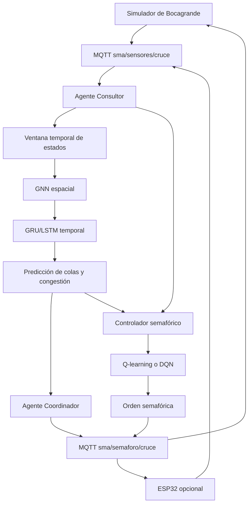

# Arquitectura híbrida de IA para control inteligente del tráfico

## 1. Propósito del documento

Este documento define la arquitectura propuesta para evolucionar el Sistema Multiagente de Movilidad y Seguridad de Bocagrande hacia un sistema híbrido de inteligencia artificial capaz de:

- Predecir la evolución de las colas y la congestión.
- Analizar la relación entre los cinco cruces semaforizados.
- Tomar decisiones adaptativas sobre los semáforos.
- Entrenar y evaluar los modelos completamente dentro de la simulación.
- Mantener compatibilidad con MQTT, el gemelo digital, los agentes SPADE y el hardware ESP32.

La simulación de Bocagrande es el entorno principal de desarrollo. Las cámaras reales y la CNN quedan como una futura fuente de datos; no son necesarias para validar la primera versión de la arquitectura.

---

## 2. Resumen ejecutivo

La arquitectura recomendada combina cuatro bloques, pero se implementará progresivamente:

```text
Simulador de Bocagrande / ESP32
          |
          v
Estado numérico del tráfico
          |
          v
GNN: relación espacial entre cruces
          |
          v
GRU/LSTM: evolución temporal de las colas
          |
          v
Predicción de tráfico
          |
          v
Q-learning actual o DQN
          |
          v
Decisión semafórica
          |
          v
MQTT -> simulador y ESP32
```

La arquitectura completa puede denominarse:

> **ST-GNN + aprendizaje por refuerzo para control adaptativo de semáforos.**

ST-GNN significa *Spatio-Temporal Graph Neural Network*: una red que aprende relaciones espaciales entre nodos de una red vial y relaciones temporales entre mediciones consecutivas.

La CNN se incorporará únicamente si se conectan cámaras o videos. En la primera etapa, el simulador suministra directamente los conteos de vehículos, colas y velocidades que representarían la salida de una CNN.

---

## 3. Situación actual del proyecto

El proyecto ya cuenta con una base funcional:

- Cinco cruces semaforizados del sector de Bocagrande.
- Simulador de tráfico y gemelo digital 3D.
- Publicación de sensores mediante MQTT.
- Siete agentes SPADE.
- Agente Consultor con historial de colas y niveles de tráfico.
- Agente Semafórico con Q-learning tabular.
- Agente Coordinador que aprende el impacto de sus planes.
- Órdenes semafóricas `normal`, `prioridad_a`, `prioridad_b`, `peatonal` y `cerco`.
- Panel web para observar el estado del sistema.
- Prueba punta a punta del flujo accidente -> decisión -> orden -> restauración.

### 3.1. Qué se conserva

La nueva arquitectura no reemplazará todo el sistema de una vez. Se conservarán:

- MQTT como bus de comunicación.
- SPADE y los agentes existentes.
- El simulador como entorno de ejecución.
- El Q-learning tabular como controlador de respaldo.
- Las reglas de seguridad y los modos `cerco` y `peatonal`.
- El Coordinador como responsable de planes de contingencia.
- La prueba punta a punta existente.

### 3.2. Qué se agregará

Se agregarán progresivamente:

1. Recolección de datos de la simulación.
2. Línea base estadística.
3. Predictor espacial y temporal GNN + GRU.
4. Integración del predictor con el Consultor y el Coordinador.
5. DQN como evolución opcional del Q-learning tabular.
6. CNN/YOLO únicamente cuando exista entrada de video.

---

## 4. Principio fundamental: la simulación es el entorno principal

Toda funcionalidad nueva debe funcionar en la simulación antes de conectarse al ESP32 o a cámaras.

El simulador cumple tres funciones:

1. **Generador de datos:** produce lecturas de colas, velocidad y vehículos detenidos.
2. **Entorno de entrenamiento:** recibe acciones semafóricas y devuelve nuevas mediciones.
3. **Entorno de evaluación:** permite comparar distintos controladores bajo los mismos escenarios.

El flujo de una iteración de entrenamiento es:

```text
1. El simulador publica el estado de los cruces.
2. El predictor recibe el historial reciente.
3. El controlador elige una acción semafórica.
4. El simulador aplica la acción.
5. Después de un intervalo, publica el nuevo estado.
6. Se calcula la recompensa.
7. El modelo se actualiza.
8. Se repite el ciclo.
```

La simulación debe permitir ejecutar escenarios reproducibles usando una semilla aleatoria:

```text
escenario_normal_seed_1
escenario_congestion_seed_1
escenario_accidente_seed_1
escenario_aglomeracion_seed_1
```

Esto es necesario para comparar Q-learning, DQN y otros controladores con las mismas condiciones.

---

## 5. Arquitectura funcional completa



### 5.1. Bloque de percepción

En la primera versión no se utilizará video. El simulador publicará directamente datos numéricos:

```json
{
  "A": 8,
  "B": 2,
  "velocidad_promedio": 24.5,
  "vehiculos_detenidos": 5,
  "peatones_esperando": 3,
  "modo": "prioridad_a",
  "ts": "2026-11-18T01:23:15"
}
```

Estos datos representan la salida que en el futuro podría producir una CNN a partir de una cámara.

### 5.2. Bloque espacial: GNN

Cada cruce se representa como un nodo del grafo vial. Las características del nodo contienen el estado local del tráfico:

```text
[cola_A, cola_B, velocidad_promedio,
 vehiculos_detenidos, peatones_esperando,
 modo_actual]
```

Las aristas representan la influencia o conexión vial entre cruces. La topología inicial debe derivarse de `maqueta_virtual/cruces.json` y validarse con la red vial de Bocagrande.

Una configuración inicial de ejemplo puede ser:

```python
ARISTAS_INICIALES = [
    ("cruce1", "cruce2"),
    ("cruce1", "cruce3"),
    ("cruce2", "cruce4"),
    ("cruce3", "cruce4"),
    ("cruce4", "cruce5"),
]
```

Esta lista es una hipótesis de trabajo. La implementación debe leer o verificar las conexiones reales antes de utilizarla como topología definitiva.

La GNN permite que el estado de un cruce considere la situación de sus vecinos. Por ejemplo, una cola creciente en `cruce4` puede influir en la decisión de `cruce3` si ambos están conectados por la misma ruta.

### 5.3. Bloque temporal: GRU o LSTM

Una única lectura no indica si el tráfico está mejorando o empeorando. Por eso el modelo recibe una ventana temporal:

```text
estado(t-4), estado(t-3), estado(t-2), estado(t-1), estado(t)
```

Cada estado incluye los cinco cruces. La GRU o LSTM recibe la representación producida por la GNN y predice el futuro:

```json
{
  "horizonte_segundos": 30,
  "cruces": {
    "cruce1": {
      "cola_A": 10.5,
      "cola_B": 3.2,
      "nivel": "alto",
      "confianza": 0.82
    },
    "cruce2": {
      "cola_A": 6.1,
      "cola_B": 7.4,
      "nivel": "medio",
      "confianza": 0.76
    }
  }
}
```

Se recomienda comenzar con GRU porque tiene menos parámetros que LSTM y es apropiada para una primera versión con datos sintéticos.

### 5.4. Bloque de decisión: aprendizaje por refuerzo

El controlador recibe:

- Estado actual.
- Predicción de los próximos segundos.
- Estado de los cruces vecinos.
- Modo semafórico actual.
- Restricciones de seguridad.

Acciones posibles:

```text
normal
prioridad_a
prioridad_b
```

Los modos `cerco` y `peatonal` deben seguir siendo acciones protegidas por reglas y por el Coordinador, ya que no conviene que un modelo exploratorio los active o desactive sin autorización.

La progresión recomendada es:

```text
Q-learning tabular actual -> DQN -> PPO/MAPPO opcional
```

El Q-learning actual funciona como línea base y respaldo. No se debe eliminar hasta que el nuevo controlador supere las pruebas de seguridad y rendimiento.

---

## 6. Diseño de los datos de simulación

### 6.1. Registro de una observación

Cada observación debe guardar:

```text
timestamp
id_escenario
semilla
cruce
cola_A
cola_B
cola_total
velocidad_promedio
vehiculos_detenidos
peatones_esperando
modo_semaforo
accion_anterior
```

Formato CSV recomendado:

```csv
timestamp,escenario,seed,cruce,cola_A,cola_B,velocidad_promedio,vehiculos_detenidos,peatones_esperando,modo_semaforo
2026-11-18T01:23:15,normal,1,cruce1,8,2,24.5,5,3,prioridad_a
```

Formato JSONL recomendado para datos de entrenamiento:

```json
{"timestamp": "2026-11-18T01:23:15", "escenario": "normal", "seed": 1, "cruces": {"cruce1": {"A": 8, "B": 2}}}
```

### 6.2. Escenarios mínimos

El recolector debe generar datos de:

1. Tráfico normal.
2. Congestión localizada.
3. Congestión propagada entre cruces.
4. Accidente en `cruce1`.
5. Accidente en `cruce5`, sentido `entrada`.
6. Accidente en `cruce5`, sentido `salida`.
7. Aglomeración peatonal.
8. Cambios de fase semafórica.
9. Variaciones de demanda vehicular.

Cada escenario debe ejecutarse varias veces con semillas distintas.

### 6.3. Separación de datos

No se deben mezclar todas las observaciones aleatoriamente. Para evaluar correctamente:

```text
70 % entrenamiento
15 % validación
15 % prueba
```

La separación debe hacerse por ejecución o escenario, no solo por filas. De lo contrario, el modelo podría ver estados casi idénticos de una misma ejecución en entrenamiento y prueba.

---

## 7. Objetivos de predicción

El primer modelo debe predecir una variable sencilla y útil:

```text
cola total de cada cruce dentro de 30 segundos
```

La cola total se define como:

```text
cola_total = cola_A + cola_B
```

Posteriormente se pueden agregar:

- Cola de A y B por separado.
- Nivel de tráfico bajo, medio o alto.
- Velocidad promedio futura.
- Probabilidad de congestión.
- Tiempo estimado de despeje.

Métricas del predictor:

- MAE: error absoluto medio.
- RMSE: raíz del error cuadrático medio.
- MAPE, solo cuando la cola real no sea cercana a cero.
- Exactitud o F1 para clasificar bajo/medio/alto.

La línea base será un predictor ingenuo:

```text
predicción(t+30) = medición actual(t)
```

El modelo GNN + GRU debe compararse contra esta línea base.

---

## 8. Integración con los agentes

### 8.1. Agente Consultor

El Consultor ya mantiene historial de lecturas y calcula el estado vial. Se ampliará para:

- Mantener una ventana temporal por cruce.
- Construir el tensor de entrada del modelo.
- Solicitar predicciones al Predictor.
- Publicar el resultado para el Coordinador y el Semafórico.

No debe entrenar el modelo durante cada consulta de producción. El entrenamiento será un proceso separado.

### 8.2. Agente Predictor

El Predictor debe admitir dos modos:

```text
heuristico
neuronal
```

Modo `heuristico`:

- Conserva la ruta fija actual.
- Se usa si no existe un modelo entrenado.
- Sirve como respaldo y comparación.

Modo `neuronal`:

- Carga un modelo guardado.
- Recibe la ventana de estados.
- Ejecuta inferencia.
- Devuelve predicción y confianza.

Ejemplo de respuesta:

```json
{
  "modelo": "gnn_gru_v1",
  "horizonte": 30,
  "predicciones": {
    "cruce1": {"cola_total": 14.0, "nivel": "alto"},
    "cruce2": {"cola_total": 8.0, "nivel": "medio"}
  },
  "confianza_media": 0.81
}
```

Si el modelo no está disponible, está corrupto o devuelve una confianza menor al umbral configurado, el Predictor debe devolver el modo heurístico y registrar el motivo.

### 8.3. Agente Coordinador

El Coordinador utilizará la predicción como una señal adicional para calcular la utilidad de los planes. La predicción no debe anular las reglas de seguridad.

Ejemplo conceptual:

```text
utilidad_plan =
    impacto_esperado * factor_trafico_actual
    + beneficio_predicho
    - peso_costo * costo
    - penalizacion_riesgo
```

El Coordinador continuará aprendiendo el impacto real de cada plan mediante sus mediciones antes/durante.

### 8.4. Agente Semafórico

En la primera integración, el Semafórico seguirá usando Q-learning tabular, pero recibirá características futuras:

```text
estado_actual + predicción_30s + estado_vecinos
```

El modelo neuronal funcionará primero como apoyo de decisión, no como reemplazo total. Después se podrá comparar con un DQN.

---

## 9. Controlador DQN como segunda etapa

El DQN reemplaza la tabla Q por una red neuronal que aproxima:

```text
Q(estado, acción)
```

Entrada sugerida:

```text
colas de los 5 cruces
velocidades de los 5 cruces
modos semafóricos
predicciones de la GRU
hora o escenario
```

Salida:

```text
Q(normal)
Q(prioridad_a)
Q(prioridad_b)
```

La recompensa inicial debe conservar la lógica actual:

```text
recompensa =
    reducción_de_cola_total
    - penalización_por_cambio
    - penalización_por_espera_peatonal
    - penalización_por_propagar_congestión
```

Restricciones:

- No activar `cerco` mediante exploración.
- No cambiar un plan bloqueado por el Coordinador.
- No explorar durante una alerta de seguridad.
- No permitir cambios excesivamente frecuentes.
- Mantener la histéresis actual para evitar parpadeo.
- Tener siempre un modo de retorno a `normal`.

---

## 10. CNN para cámaras: etapa futura

La CNN no es necesaria para la simulación inicial porque el simulador ya conoce los vehículos. Se agregará cuando exista una fuente de video.

Flujo futuro:

```text
Video
  -> CNN/YOLO
  -> detección de vehículos
  -> conteo por acceso
  -> estimación de cola y velocidad
  -> GNN + GRU
  -> DQN/PPO
```

Para que la integración no cambie los agentes, la CNN debe publicar el mismo contrato numérico que actualmente publica el simulador:

```json
{"A": 8, "B": 2, "velocidad_promedio": 24.5}
```

Así, el Consultor no necesitará saber si los datos vienen del simulador, un ESP32 o una cámara.

---

## 11. Organización de archivos propuesta

```text
modelos/
├── __init__.py
├── grafo_bocagrande.py
├── esquema_datos.py
├── recolectar_datos.py
├── preparar_datos.py
├── linea_base.py
├── predictor_gnn_gru.py
├── entrenar_predictor.py
├── evaluar_predictor.py
├── dqn_semaforico.py
├── escenarios.py
├── datos/
│   ├── README.md
│   └── .gitkeep
└── modelos_entrenados/
    └── .gitkeep

pruebas/
├── prueba_punta_a_punta.py
├── prueba_grafo.py
├── prueba_datos.py
├── prueba_predictor.py
└── prueba_controlador.py
```

Dependencias recomendadas para la etapa neuronal:

```text
torch
numpy
pandas
scikit-learn
```

`torch-geometric` se agregará cuando se implemente la primera GNN. No se debe agregar toda la pila pesada antes de validar el formato de datos y la línea base.

---

## 12. Fases de implementación

### Fase A: datos y reproducibilidad

1. Crear el recolector MQTT.
2. Guardar datos de los cinco cruces.
3. Añadir identificador de escenario y semilla.
4. Definir el esquema de datos.
5. Crear escenarios repetibles.
6. Verificar que el simulador publica lecturas suficientes.

**Resultado:** archivos de datos reproducibles y documentados.

### Fase B: línea base

1. Implementar el predictor de persistencia.
2. Calcular MAE y RMSE.
3. Medir cola, espera y velocidad sin modificar el controlador.
4. Crear una comparación semáforo fijo vs Q-learning.

**Resultado:** referencia cuantitativa para saber si la red neuronal mejora el sistema.

### Fase C: predictor GNN + GRU

1. Validar la topología de los cinco cruces.
2. Implementar el tensor espacial.
3. Implementar una GCN sencilla.
4. Añadir una GRU temporal.
5. Entrenar para horizonte de 30 segundos.
6. Evaluar contra la línea base.
7. Guardar el modelo y sus parámetros.

**Resultado:** modelo de predicción independiente y probado.

### Fase D: integración segura

1. Agregar modo `neuronal` al Predictor.
2. Mantener modo `heuristico` como respaldo.
3. Publicar las predicciones en la mente de los agentes o en MQTT.
4. Incorporar la predicción al Coordinador.
5. Mantener Q-learning como controlador principal.
6. Ejecutar la prueba punta a punta.

**Resultado:** el sistema usa predicciones sin perder la estabilidad actual.

### Fase E: DQN

1. Definir estado y acciones.
2. Implementar memoria de experiencias.
3. Implementar red Q.
4. Entrenar únicamente en simulación.
5. Comparar contra Q-learning tabular.
6. Activar DQN solo con confianza y métricas suficientes.

**Resultado:** controlador neuronal validado en el gemelo digital.

### Fase F: CNN y video

1. Seleccionar detector preentrenado.
2. Convertir detecciones a conteos por acceso.
3. Publicar el contrato MQTT existente.
4. Comparar conteos visuales contra el simulador.
5. Integrar la fuente visual sin cambiar el resto de agentes.

**Resultado:** percepción visual compatible con la arquitectura.

---

## 13. Métricas del sistema completo

Cada controlador debe evaluarse bajo los mismos escenarios y semillas.

Métricas principales:

- Cola promedio por cruce.
- Cola máxima.
- Tiempo promedio detenido.
- Velocidad promedio.
- Tiempo de viaje.
- Número de cambios de fase.
- Tiempo de respuesta ante un evento.
- Cantidad de vehículos atendidos.
- Espera peatonal.
- Congestión propagada a cruces vecinos.
- Recompensa acumulada.

Comparaciones obligatorias:

```text
1. Semáforo fijo vs Q-learning tabular.
2. Q-learning tabular vs Q-learning con predicción.
3. Q-learning vs DQN.
4. DQN sin contexto espacial vs GNN + GRU + DQN.
5. Controlador neuronal con respaldo vs sin respaldo.
```

Los resultados deben guardarse en CSV y mostrarse mediante tablas y gráficas del proyecto.

---

## 14. Seguridad y reglas no aprendibles

El aprendizaje automático no debe controlar directamente todas las decisiones. Las siguientes reglas deben permanecer deterministas:

- Un plan de cerco de seguridad solo puede activarse por el flujo autorizado del Coordinador.
- El DQN no puede desactivar un cerco activo.
- El modo peatonal debe respetar su duración mínima.
- Debe existir un tiempo mínimo entre cambios de fase.
- Toda acción desconocida debe convertirse en `normal`.
- Si falla MQTT, el agente debe registrar el error y conservar el último modo seguro.
- Si falla el modelo, se usa Q-learning tabular o regla heurística.
- Los modelos entrenados no se deben desplegar sin validación en simulación.

---

## 15. Criterios de aceptación

La arquitectura se considerará implementada de forma inicial cuando cumpla:

1. El simulador genera y guarda datos reproducibles de los cinco cruces.
2. Existe una línea base de predicción.
3. El predictor GNN + GRU supera o iguala la línea base en los escenarios definidos.
4. El Predictor puede funcionar en modo heurístico y neuronal.
5. Una falla del modelo no detiene los agentes.
6. Las predicciones se observan en el panel o mediante MQTT.
7. El Coordinador puede utilizar la predicción sin romper sus reglas.
8. El Q-learning actual continúa funcionando como respaldo.
9. La prueba punta a punta sigue pasando.
10. Se comparan cuantitativamente los controladores.
11. Ninguna exploración neuronal puede romper los modos de seguridad.
12. Todo el flujo funciona sin cámaras ni ESP32, usando únicamente el simulador.

---

## 16. Recomendación de implementación inmediata

El siguiente trabajo no debe comenzar entrenando PPO ni una CNN. El orden recomendado es:

```text
1. Recolector de sensores del simulador.
2. Esquema de datos y escenarios reproducibles.
3. Línea base de predicción.
4. Grafo de los cinco cruces.
5. Predictor GNN + GRU.
6. Integración en modo lectura, sin controlar semáforos todavía.
7. Integración con el Coordinador.
8. Comparación contra Q-learning.
9. DQN como etapa posterior.
10. CNN únicamente si se agregan cámaras.
```

La primera entrega concreta debe ser:

> **Un recolector de datos de la simulación y una línea base que prediga la cola futura de cada cruce.**

Esto permite comprobar el ciclo completo de datos antes de añadir complejidad neuronal.

---

## 17. Comandos de trabajo previstos

Los comandos exactos se definirán cuando se agreguen los módulos, pero el flujo previsto será:

```bash
# Instalar dependencias de modelos
pip install torch numpy pandas scikit-learn

# Recolectar datos desde la simulación
python modelos/recolectar_datos.py --duracion 600 --escenario normal --seed 1

# Preparar ventanas temporales
python modelos/preparar_datos.py --entrada modelos/datos/trafico.jsonl

# Entrenar el predictor
python modelos/entrenar_predictor.py --modelo gnn_gru --epocas 50

# Evaluar el predictor
python modelos/evaluar_predictor.py --modelo modelos_entrenados/predictor_gnn_gru.pt

# Ejecutar los agentes con respaldo heurístico
python agentes/sma_agentes.py --modo-predictor heuristico

# Ejecutar los agentes usando el modelo neuronal
python agentes/sma_agentes.py --modo-predictor neuronal --modelo-predictor modelos/modelos_entrenados/predictor_gnn_gru.pt
```

Estos comandos son el objetivo de la integración y no deben considerarse disponibles hasta que los módulos correspondientes sean implementados.

---

## 18. Conclusión

La arquitectura propuesta permite avanzar desde el sistema actual hacia un controlador inteligente sin perder lo que ya funciona.

La simulación de Bocagrande será el centro de todo el proceso: generará los datos, permitirá entrenar los modelos, recibirá las acciones y proporcionará las métricas. El ESP32 y las cámaras serán fuentes de datos adicionales compatibles con el mismo contrato MQTT.

La estrategia recomendada es modular:

```text
Simulación
  -> datos reproducibles
  -> línea base
  -> GNN + GRU
  -> integración con Q-learning
  -> DQN
  -> CNN para cámaras
  -> PPO/MAPPO opcional
```

De esta forma, cada etapa puede probarse, medirse y demostrarse académicamente antes de continuar con la siguiente.
