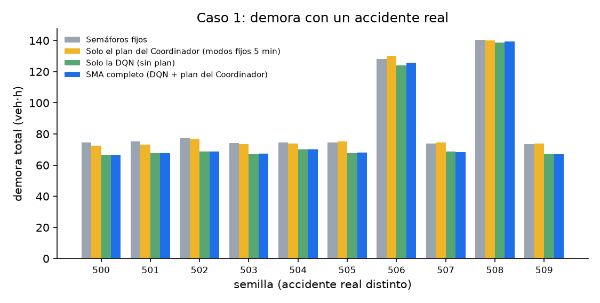
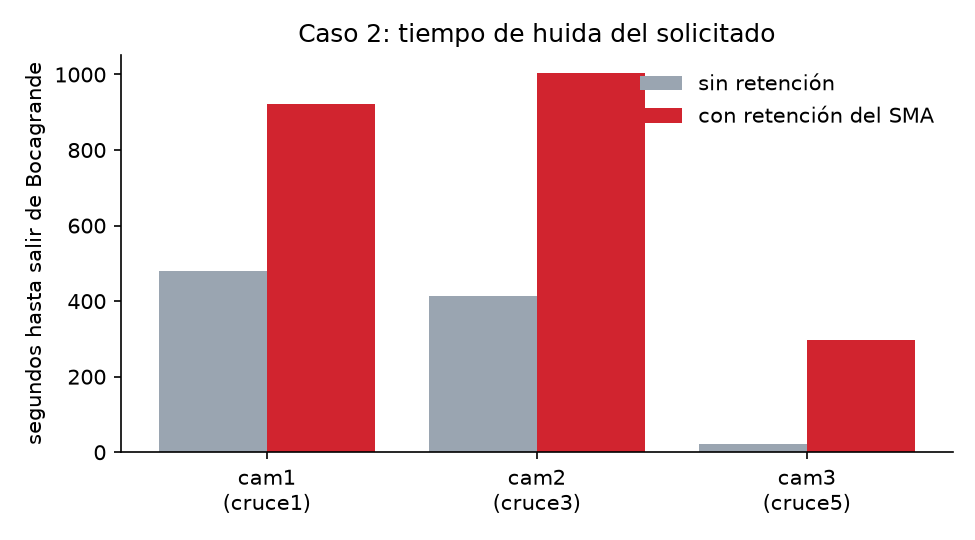
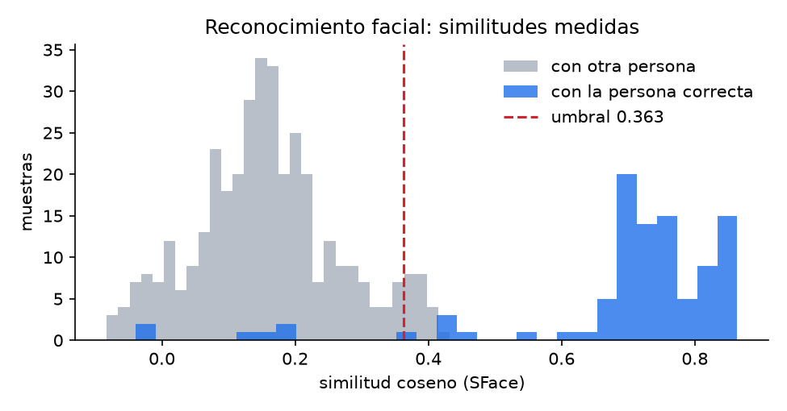

# Resultados del SMA Movilidad y Seguridad – Bocagrande

Generado con `python mediciones/medir.py informe` el 22-11-2026 17:19. Media ± intervalo de confianza del 95 % (t de Student). Semillas fijas: los experimentos se pueden repetir.

## 1. Caso 1 – Accidente real → plan de desvío (SUMO, hora pico 17 h, 30 min)

Cada semilla sortea un accidente real del DATT (tramo con su frecuencia real en Bocagrande). Todas las políticas ven el MISMO tráfico y el MISMO accidente; el plan es el que elige el Coordinador (modelo de equilibrio + utilidad) y rige 5 min desde que ocurre el accidente.

| Política | Demora total (veh·h) | Viaje medio (s) | Vehículos que llegaron |
|---|---|---|---|
| Semáforos fijos | 86.7 ± 18.1 | 350.9 ± 11.9 | 1590 ± 106 |
| Solo el plan del Coordinador (modos fijos 5 min) | 86.3 ± 18.5 | 344.9 ± 12.0 | 1574 ± 100 |
| Solo la DQN (sin plan) | 80.6 ± 19.3 | 316.3 ± 9.4 | 1678 ± 106 |
| SMA completo (DQN + plan del Coordinador) | 80.9 ± 19.6 | 316.6 ± 9.4 | 1673 ± 102 |

Mejora frente a semáforos fijos, pareada por semilla (mismo tráfico y mismo accidente):

| Política | Reducción de la demora | Reducción del viaje medio | Accidentes en que baja la demora |
|---|---|---|---|
| Solo el plan del Coordinador (modos fijos 5 min) | **0.5 % ± 1.0** | 1.7 % ± 1.0 | 6 de 10 |
| Solo la DQN (sin plan) | **7.8 % ± 2.4** | 9.8 % ± 1.0 | 10 de 10 |
| SMA completo (DQN + plan del Coordinador) | **7.5 % ± 2.6** | 9.7 % ± 1.0 | 10 de 10 |

| Semilla | Tramo del accidente | Cruce | Plan elegido | Modos del plan | Demora fijo → SMA completo (veh·h) |
|---|---|---|---|---|---|
| 500 | Carrera 1 | cruce3 | Semáforos optimizados (4 cruces) | cruce1:prioridad_a, cruce3:prioridad_a, cruce4:prioridad_a, cruce5:prioridad_a | 74.7 → 66.4 |
| 501 | Carrera 5 | cruce2 | Semáforos optimizados (4 cruces) | cruce1:prioridad_a, cruce3:prioridad_a, cruce4:prioridad_a, cruce5:prioridad_a | 75.2 → 67.6 |
| 502 | Carrera 1 | cruce1 | Semáforos optimizados (4 cruces) | cruce1:prioridad_a, cruce3:prioridad_a, cruce4:prioridad_a, cruce5:prioridad_a | 77.2 → 68.7 |
| 503 | Carrera 7 | cruce2 | Semáforos optimizados (4 cruces) | cruce1:prioridad_a, cruce3:prioridad_a, cruce4:prioridad_a, cruce5:prioridad_a | 74.3 → 67.5 |
| 504 | Carrera 3 | cruce2 | Semáforos optimizados (4 cruces) | cruce1:prioridad_a, cruce3:prioridad_a, cruce4:prioridad_a, cruce5:prioridad_a | 74.6 → 70.2 |
| 505 | Carrera 1 | cruce1 | Semáforos optimizados (4 cruces) | cruce1:prioridad_a, cruce3:prioridad_a, cruce4:prioridad_a, cruce5:prioridad_a | 74.4 → 68.2 |
| 506 | Avenida San Martín | cruce3 | Semáforos optimizados (5 cruces) | cruce1:prioridad_a, cruce2:prioridad_b, cruce3:prioridad_a, cruce4:prioridad_a, cruce5:prioridad_b | 128.2 → 125.6 |
| 507 | Calle 9 | cruce4 | Semáforos optimizados (3 cruces) | cruce1:prioridad_a, cruce3:prioridad_a, cruce5:prioridad_a | 74.0 → 68.5 |
| 508 | Avenida San Martín | cruce5 | Semáforos optimizados (5 cruces) | cruce1:prioridad_a, cruce2:prioridad_b, cruce3:prioridad_a, cruce4:prioridad_a, cruce5:prioridad_b | 140.4 → 139.3 |
| 509 | Carrera 6 | cruce2 | Semáforos optimizados (4 cruces) | cruce1:prioridad_a, cruce3:prioridad_a, cruce4:prioridad_a, cruce5:prioridad_a | 73.5 → 67.1 |

## 2. Caso 2 – Retención semafórica del solicitado (SUMO, hora pico)

El solicitado es detectado a 60 m de un cruce con cámara y huye hacia la salida de Bocagrande. Se compara el tiempo que tarda en salir con semáforos normales y con la retención que ordena el SMA (cerco en la ruta más probable del Predictor y rojo largo en su acceso en las alternas, 5 min).

| Cámara (cruce) | Ruta predicha (prob.) | Huida sin retención (s) | Huida con retención (s) | Tiempo ganado para la Policía (s) | Demora extra del resto (veh·h) |
|---|---|---|---|---|---|
| cam1 (cruce1) | Calle 6 → Carrera 3 → Calle 10A → Avenida San Martín (0.6) | 481 ± 206 | 921 ± 220 | **441 ± 354** | 36.2 ± 17.9 |
| cam2 (cruce3) | Avenida San Martín → Carrera 2 → Calle 9 → Carrera 1 → Calle 15 (0.58) | 415 ± 51 | 1003 ± 173 | **588 ± 171** | 39.2 ± 10.5 |
| cam3 (cruce5) | Calle 15 (1.0) | 21 ± 12 | 298 ± 34 | **277 ± 29** | 16.4 ± 1.6 |

La retención le da a la Policía minutos en vez de segundos para llegar al punto de intercepción; el costo es demora para los demás conductores durante el cerco (por eso dura solo 5 min y solo en la ruta probable).

## 3. Tiempo de respuesta de la cadena de agentes

Desde que llega el evento (botón/cámara) hasta que los semáforos reciben el plan y hasta que el Comunicador tiene el aviso redactado (incluye el modelo de equilibrio y el LLM).

| Caso | Evento → semáforos (s) | Evento → aviso redactado (s) | n |
|---|---|---|---|
| Caso 1 (accidente) | 0.5 ± 0.2 | 21.3 ± 2.6 | 8 |
| Caso 2 (persona solicitada) | 0.0 ± 0.0 | 19.5 ± 2.5 | 8 |

## 4. Comunicador: redacción con LLM local (Ollama llama3.2:3b)

Avisos reales del SMA. 'LLM' = el texto del modelo pasó el control (conserva cruces, calles, cifras, el alias y 'posible coincidencia'); si no, sale la plantilla.

| Receptor | Avisos | Redactados por el LLM | Plantilla | Tiempo de redacción (s) |
|---|---|---|---|---|
| Ciudadania | 10 | 10 (100 %) | 0 | 11.1 ± 2.0 |
| Policia | 3 | 0 (0 %) | 3 | 17.2 ± 11.8 |

## 6. Reconocimiento facial (YuNet + SFace) con compañeros reales

6 tomas, 117 muestras; 4 personas registradas, 20 muestras de personas NO registradas. Solo se guardaron similitudes (ni imágenes ni vectores); los alias se muestran como P1, P2…
Se excluyeron 1 toma(s) hechas contra otro registro y 3 muestra(s) de cambio de persona (la captura empezó con el participante anterior aún frente a la cámara; el sistema lo reconoció a él con similitud ≥ 0.6, así que no son errores del reconocimiento).

Con el umbral del Consultor (0.363):

| Métrica | Valor |
|---|---|
| Registrado identificado correctamente (verdadero positivo) | 93.8 % |
| Registrado confundido con OTRO registrado | 0.0 % |
| No registrado tomado como solicitado (falso positivo) | 0.0 % |
| Similitud con la persona correcta (media) | 0.694 |
| Similitud con otra persona (media) | 0.159 |

| Condición | Muestras | Decisiones correctas |
|---|---|---|
| frente | 20 | 95.0 % |
| frente, lejos (~2 m), poca luz | 77 | 93.5 % |
| frente, lejos (~2 m), poca luz, de lado | 20 | 100.0 % |

Efecto del umbral:

| Umbral | Acierto de registrados | Confusiones | Falsos positivos (no registrados) |
|---|---|---|---|
| 0.25 | 93.8 % | 0.0 % | 10.0 % |
| 0.3 | 93.8 % | 0.0 % | 0.0 % |
| 0.363 (actual) | 93.8 % | 0.0 % | 0.0 % |
| 0.4 | 92.8 % | 0.0 % | 0.0 % |
| 0.45 | 88.7 % | 0.0 % | 0.0 % |
| 0.5 | 88.7 % | 0.0 % | 0.0 % |
| 0.55 | 88.7 % | 0.0 % | 0.0 % |

| Persona | Decisiones correctas |
|---|---|
| P1 | 37/40 |
| P2 | 19/19 |
| P3 | 19/19 |
| P4 | 16/19 |
| no registrado | 20/20 |

## 5. Redes neuronales (ya medidas al entrenarlas)

- Predictor (T-GCN): `modelos/entrenados/metricas_bocagrande.json` y `prediccion_bocagrande.png`.
- Semafórico (DQN) frente a fijo, tabla Q y max-presión: `modelos/entrenados/comparacion_controladores.*`.
